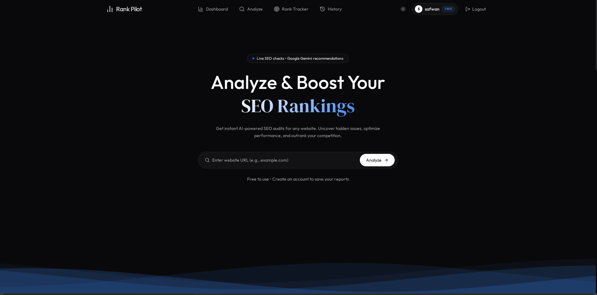

# SEO Rank Tracker
this is a simple website for it to checks your rankings, audits the page, and an AI suggests what to improve.
I built this because I wanted to see where my websites rank on Google and what to fix, without paying for a big SEO tool.  

<p align="center">
  
</p>


## PROJECT LINK 
<a href="https://seo-rank-tracker-dusky.vercel.app/" target="_blank">
  <button style="background-color: #0070f3; color: white; padding: 10px 20px; border: none; border-radius: 5px; font-weight: bold; cursor: pointer;">
   CLICK HERE
  </button>
</a>


## What it does
- **Rank tracker:** enter your website and a keyword, and it opens a real browser (Browserbase) to search Google and find where you show up. You get your position, a graph of how it changes, and the competitors ranking around you. I used a real browser so the results match what a person would actually see on Google
- **Website audits:** scans a page and reports SEO problems, such as [titles, meta descriptions, headings, imge audits]. Each problem is sorted into **critical**, **warning**, or **info**, so you know what to fix first.
- **History:** every check is saved, so you can look back at old results and see how your rankings change over time.
- **Gemini recommendations:** after an audit,  Gemini  reads the results and point out the mportant SEO issues and gives scores out of 100 .

  

## Screenshots

### Audit


### History


### Rank tracker


### Dash Board 


## Tech stack


 - Frontend - React, Vite, React Router, Tailwind CSS, TypeScript 
 - Backend - Node.js API (nodemon in dev) 
 - Database - MongoDB Atlas 
 - Rank checking - Browserbas  
 - AI - Gemini 2.5 Flash through the Hack Club AI proxy (OpenAI-compatible) 
 - Hosting - Vercel (app and API) 

## Project structure

```
seo-rank-tracker/
-  client/   # React frontend
-  server/   # Node API, talks to MongoDB, Browserbase and the AI
```

## Getting started

**You need:** Node.js 18+, a MongoDB Atlas cluster, and a Browserbase API key (or your own Browserless).

```bash
git clone https://github.com/Ssafwa/SEO-RANKTRACKER
cd seo-rank-tracker
```

**1. Server**

```bash
cd server
npm install
cp .env.example .env  
npm run server
```

`server/.env` needs:

```
MONGODB_URL=your_atlas_connection_string
BROWSERBASE_API_KEY=your_key
AI_API_KEY=your_key
```

**2. Client**

```bash
cd client
npm install
npm run dev
```

## License

MIT

## Author

Made by safwan, https://github.com/Ssafwa

> [!NOTE]
> A NOTE FOR HACKCLUB SHIPWRIGHTS
> This readme is fully writen by me 
>  

> and this website took me above 18  houres so i dont use any ai 


